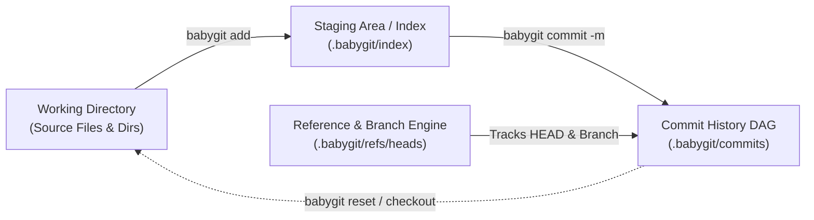

# ⚙️ BabyGit — A Git Version Control System Implemented in C

[](https://en.wikipedia.org/wiki/C99)
[](https://pubs.opengroup.org/)
[](LICENSE)

**BabyGit** is a lightweight, low-level distributed version control system (VCS) written from scratch in pure C. It directly manipulates the POSIX filesystem to recreate core Git primitives—including object hashing, an explicit staging index, directed acyclic graph (DAG) commit histories, branch pointer movement, recursive tree snapshots, and rollback mechanisms.

---

## 🏛️ Architecture & Internal Mechanics



### Core Primitives:
1. **Repository Layout (`.babygit/`)**: Initialized repository directory housing stage manifests, commit objects, local configurations, and branch pointers.
2. **Staging Pipeline (`CheckStage`, `StageFolder`, `GitAdd`)**: Computes recursive file status, detects modified vs untracked assets, and stages snapshot deltas into the staging table.
3. **Commit Engine (`PerformCommit`, `DisplayCommit`)**: Synthesizes parent-linked commit nodes containing author metadata, UTC timestamps, commit log messages, and immutable file trees.
4. **State Navigation & Rollbacks (`Reset`, `redo`)**: Traversable revision history allowing developers to unstage modifications or revert working copies to previous snapshots.
5. **Configuration Hierarchy (`CreatConfig`)**: Dual-tier configuration engine prioritizing local project configurations (`.babygit/config`) with fallback to global user defaults (`~/.babygitconfig`).

---

## 🛠️ Build & Installation

### Prerequisites
- GCC or Clang supporting **C99** or newer
- POSIX-compliant environment (Linux, macOS, or WSL / MSYS2 on Windows)

### Compilation

Compile with strict compiler warnings and optimization:

```bash
# Compile executable
gcc -std=c99 -Wall -Wextra -O2 main.c -o babygit

# Verify build
./babygit --help
```

---

## 💻 Command Reference

| Command | Syntax | Description |
| :--- | :--- | :--- |
| **Initialize Repository** | `./babygit init` | Initializes a `.babygit` repository directory in the current working directory. |
| **Configure User** | `./babygit config --global user.name "<name>"` | Sets global or repository-level committer credentials. |
| **Stage Changes** | `./babygit add <path>` | Stages a single file or recursively stages an entire directory tree. |
| **Commit Snapshot** | `./babygit commit -m "<message>"` | Records a staged snapshot to the commit log with metadata and parent links. |
| **View Log** | `./babygit log` | Displays chronological commit history, committer details, and tree state. |
| **Reset / Unstage** | `./babygit reset <path>` | Unstages a file from the staging area or reverts working directory changes. |
| **Redo** | `./babygit redo` | Restores reverted changes or re-applies the most recent undone state. |

---

## 📂 Source Code Layout

```text
BabyGit/
├── main.c           # Monolithic core systems implementation (1,279 lines)
│                    # - File traversal & dirent handling
│                    # - Staging index manipulation
│                    # - Commit object generation & serialization
│                    # - Branch pointer & config management
├── .gitignore       # Build artifact exclusions (*.o, babygit, .vscode/)
└── README.md        # Technical architecture & command documentation
```

---

## ⚠️ Hygiene & Production Recommendations

1. **Purge Checked-in Binary**: The pre-compiled ELF binary `main` committed in the repository root should be removed from git tracking via `git rm --cached main` to keep the codebase clean.
2. **Automate with Makefile**: Integrate a standard `Makefile` with targets for `all`, `debug`, `clean`, and `test`.
3. **De-monolith Architecture**: Refactor `main.c` into modular translation units (`src/index.c`, `src/commit.c`, `src/fs.c`, `include/babygit.h`) for enhanced maintainability.

---

## 📄 License

This project is licensed under the [MIT License](LICENSE).
